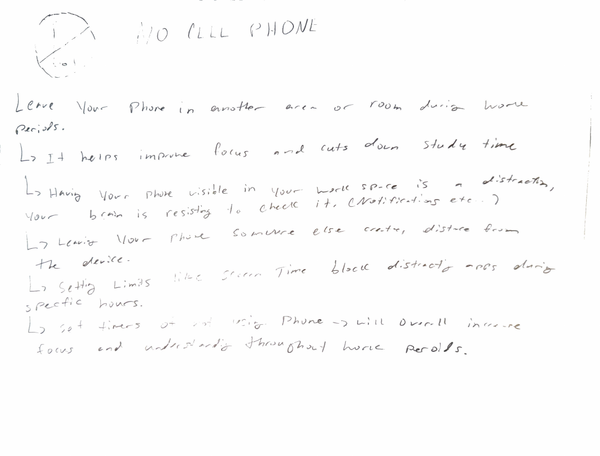
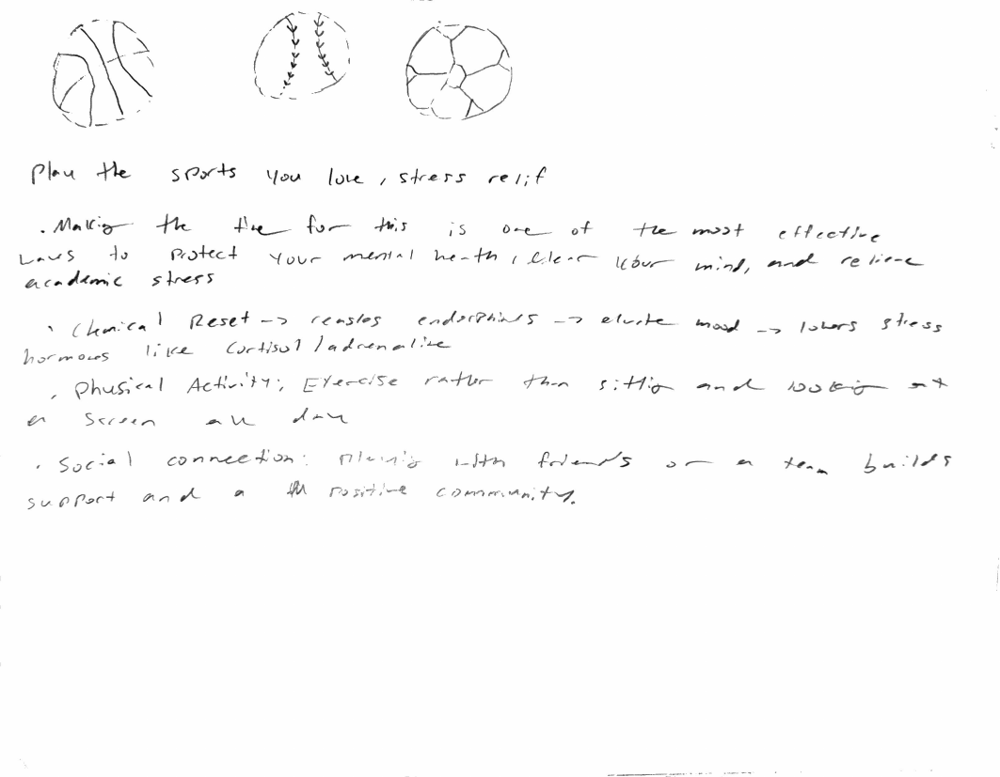
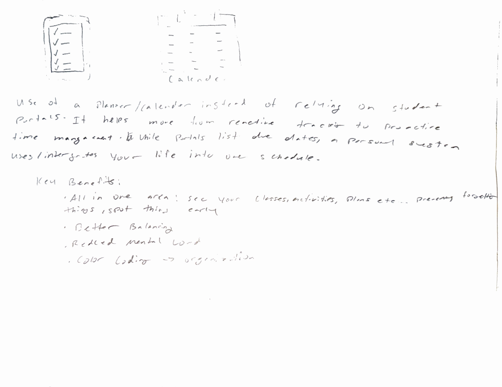

# Design Process: Helping a Student Manage Homework & Stress

## Interview

I talked to my peer/classmate/friend. We disscussed his habits, what he prioritizes, his schedule, and what is happening in his life. I learned his specfic habits that I didn't know about him, specfically his study habits.  

## Principles

One of the most importnat things for this person is his balance between school and social life. He wants to exel in schools while maintaing a good connection with friends and family. A problem I found was his study habits and mangament of his life.

## Raw Ideas

1. Stay in contact with family (phone calls, texts) using a planner, reminder system, or schedule
2. Maintain a balance between social life and school (hang out with friends while studying, time in school)
3. Sustain your love for sports, as it will make you happier
4. Avoid procrastination and use your time wisely. Time is one thing money cannot buy
5. Make use of a planner/calendar instead of relying on school portals
6. Study with an open mind and focus on the process, not the result
7. Play the sports that you love for stress relief
8. To avoid procrastination, add phone restrictions or put your phone in another room
9. Save harder thinking work for when you're most alert, and leave simple tasks for later
10. Check messages only during planned breaks
11. Leave your phone in another room during work periods, or set limits
12. Pick study partners to check in with, or keep study based relationships. 

## Gallery Sketches

### 1. No Cell Phone

Leave your phone in another area or room during work periods.

- It helps improve focus and cuts down study time.
- Having your phone visible in your workspace is a distraction, your brain is resisting checking it (notifications, etc.).
- Leaving your phone somewhere else creates distance from the device.
- Set limits like Screen Time to block distracting apps during specific hours.
- Set timers for not using your phone, which will increase focus and understanding throughout work periods.

### 2. Play the Sports You Love

Play the sports you love for stress relief. Making time for this is one of the most effective ways to protect your mental health, clear your mind, and relieve academic stress.

- **Chemical reset:** releases endorphins, which elevate mood and lower stress hormones like cortisol and adrenaline.
- **Physical activity:** exercise rather than sitting and looking at a screen all day.
- **Social connection:** playing with friends or on a team builds support and a positive community.

### 3. Planner / Calendar

Use a planner or calendar instead of relying on student portals. It helps you move from reactive tracking to proactive time management. While portals list due dates, a personal system integrates your whole life into one schedule.

**Key benefits:**

- **All in one area:** see your classes, activities, plans, etc., preventing forgotten things and spotting things early
- Better balancing
- Reduced mental load
- Color coding for organization

## Experiment & Path Forward

Locked in factime study and work periods with friends

## Reflections

I learned more problem solving, and idea creating skills as this required me to create ideas and solve a specfic problem. The most interesting thing was getting to know my friends life better, learning his habits and challenges. I will take more advancded listeing skills and understanding off others.
